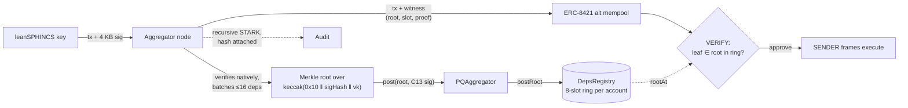

# QueueBit

**A quantum-safe wallet for Ethereum, today.** Every payment is signed with a hash-based key a quantum computer can’t
forge, and costs about as much as an ordinary one.

Try it: [queuebit.space](https://www.queuebit.space) (public EIP-8141 devnet, chain 1337).

**Admitted by the alt mempool and mined** (devnet explorer; times in IST, UTC+5:30):

- [Quantum-safe payment, no stake](https://explorer.altmempool.wtf/tx/0x35ec542469877d81152701dd128ba29d859a23bd1efaf77f4fbcf521b3423602?node=https%3A%2F%2Faltmempool.forshtat.com%2Frpc):
  block 11014, 07 Nov 2026, 06:22 IST. VERIFY checks the batch-root proof; the public mempool refuses this tx.
- [Private withdrawal from a 0-ETH address](https://explorer.altmempool.wtf/tx/0x8e1440801b3a2464321e05cd127852581e6e4ce25afcb12217aecc3a326bc23a?node=https%3A%2F%2Faltmempool.forshtat.com%2Frpc):
  block 10365, 07 Nov 2026, 05:17 IST. The privacy pool pays the gas in the same frame transaction, with no relayer.
- Code that submits one: [`services/leanpool-node/src/chain.ts`](services/leanpool-node/src/chain.ts#L278), `submit()`.

## The problem

Quantum computers will break ECDSA, the signature behind almost every Ethereum account. Hash-based signatures are the
safe replacement, but they are big: a leanSPHINCS signature is 4 KB, and checking one on chain costs about
**383,000 gas** (around $11 at 10 gwei).

## Why it costs 4.5× less

A post-quantum signature is expensive in two ways: the EVM has to recompute thousands of hashes to check it, and its
4 KB must be posted as calldata, every transaction. QueueBit does neither on chain:

- **The signature never reaches the chain.** An off-chain node checks it natively, where hashing is free.
- **The chain checks a short Merkle proof instead**, that the transaction is in a batch the node vouched for: a few
  hashes, a few thousand gas.
- **The batch costs are shared.** One root and one proof cover many transactions, so each pays only a slice.

| Per payment (20 payments, from receipts) | Signature checked in the EVM | QueueBit |
|---|---|---|
| The transaction itself | 383,018 | 56,912 |
| Its share of posting the batch root | – | 15,625 |
| Its share of the batch’s STARK hash | – | 13,061 |
| **Total** | **383,018** | **85,598** |
| Signature bytes on chain | ~5,700 | 0 |

The fuller the batch, the smaller each share.

## Why it needs no stake

An alternative mempool has to protect itself: if a transaction’s validity depended on shared state, one change could
invalidate thousands of pending transactions at once. So ERC-7562 lets validation read only storage *associated with
the sender*; anything else requires the account to post a stake and earn reputation.

QueueBit’s validation reads exactly two things, and both are stored **under the account’s own address**: its keys and
policy in the keystore, and its own ring of recent batch roots in the registry. Only the account’s own data can change
its validity, so the mempool admits it **without stake** (rule STO-021). It also stays inside the unstaked gas budget:
70–87k of the 100k allowed. The public mempool refuses the same transaction, because it allows no outside reads at all.

## How it works

### Frame transactions

Every QueueBit payment is an [EIP-8141](https://eips.ethereum.org/EIPS/eip-8141) frame transaction: a **VERIFY** frame
in which the account decides whether the transaction is valid, then **SENDER** frames that execute it. The account
(LeanAccount, ERC-8286 + ERC-7579) hands VERIFY to its keystore module, so the signature scheme is the account’s choice,
not the protocol’s.

### EIP-8288, implemented today

[EIP-8288](https://eips.ethereum.org/EIPS/eip-8288) moves post-quantum signature checks out of the EVM: a transaction
declares a **dependency** on its signature instead of carrying it, nodes verify and aggregate signatures off chain, and
blocks carry one recursive proof. QueueBit runs the same design on today’s devnet:



- **Dependency, not signature.** The transaction lists a dependency triple `(scheme 0x10, sigHash, vk)`; the 4 KB
  leanSPHINCS signature goes only to the aggregator. The leaf is `keccak(0x10 ‖ SIG_HASH ‖ vk)`.
- **Aggregation.** The node verifies each signature natively, gossips them to peers as EIP-8288 wrappers (mode 0: raw
  signatures), batches up to 16 dependencies, and posts the batch’s **Merkle root** into the `DepsRegistry` ring of
  every account in it (8 recent roots per account).
- **Late witness.** The node puts `(root, ring slot, Merkle proofs)` into a signature entry with an empty `msg`. EIP-8141
  leaves such entries out of `SIG_HASH`, so the owner’s signature stays valid when the witness is filled in after
  signing.
- **Proof.** For every batch the node proves a recursive leanVM STARK over all its signatures (mode 1) and attaches its
  hash on chain; `queuebit-leanpool-verify-batch` checks it against the posted root.
- **Where we differ.** EIP-8288 puts the recursive STARK in the block by hard fork. Without the fork, the root is posted
  by a bonded aggregator that the account names in its policy. When EIP-8288 ships, the root can be swapped for the
  block’s proof; accounts don’t change.

### A quantum-safe root

Accounts trust only roots their named aggregator posts, so that aggregator must not be ECDSA. It is the `PQAggregator`
contract: it posts a root only with a **SPHINCS- C13** (hash-based) signature over an EIP-712 digest (chain, contract,
registry, root, count, wallets, nonce), checked in execution. The node’s ECDSA key only pays gas; breaking it can’t forge
a root. Cost: ~206k gas per root on top of a plain post, shared by the whole batch.

### No stake, under budget

ERC-7562 lets a validation read only storage “associated” with the sender unless the entity is staked. QueueBit’s VERIFY
reads two things: the keystore’s keys and policy, and the registry’s ring, both stored under mappings keyed by the
account’s address (STO-021). The public mempool rejects this (`StorageReadNonSender`); the **ERC-8421 alt mempool admits
it unstaked**. VERIFY uses 70–87k gas, inside the 100k `MAX_VERIFY_GAS`. It reads no clock (TIMESTAMP is banned in
validation), so session expiry is enforced in execution. A CI lint (`contracts/script/lint-verify.sh`) keeps every VERIFY
path inside these rules.

### Keyed nonces

Owner payments use their own [EIP-8250](https://eips.ethereum.org/EIPS/eip-8250) nonce lane (key `0x1000`) and every
session key gets its own, so a session payment never waits behind an owner payment that is still being batched.

## What you can do

- **Pay** with the quantum-safe key; the first payment also creates your account. Unlock the wallet with a password or
  a passkey.
- **Move in any wallet**: MetaMask or any EOA (or keep its address with EIP-7702), a **Safe** (its owners sign once and
  it becomes your PQ account), or an upgradeable smart account (upgraded in place).
- **Pay privately with no relayer**: make funds private with Privacy Pools, then send from a brand-new address that
  never held ETH. The pool pays the gas inside the same frame transaction, which only frame transactions allow.
  Kohaku-compatible.
- **Let someone spend** within limits you set (per payment, per day, until a time you pick), or use your MetaMask as a
  capped session key.
- **Guardians** can reset your keys if you lose access, after a delay you can cancel.

## How it’s built

| Path | What |
|---|---|
| [`contracts/`](contracts/) | LeanAccount (ERC-8286 + ERC-7579), its keystore, spending-limit hook, guardian recovery; the root registry and `PQAggregator`; the privacy paymaster |
| [`services/leanpool-node`](services/leanpool-node/) | The aggregator: verifies, batches, posts roots, proves STARKs |
| [`packages/account`](packages/account/) | The SDK: keys, sessions, grants, migration, Safe adapter |
| [`apps/web`](apps/web/) | The wallet ([queuebit.space](https://www.queuebit.space)): onboarding, Send, private balance, permissions |
| [`apps/extension`](apps/extension/) | The browser extension and the wallet engine both apps run |
| [`packages/privacy`](packages/privacy/), [`packages/groth16`](packages/groth16/) | Privacy Pools client and an in-browser Groth16 prover |
| [`packages/lean-sphincs`](packages/lean-sphincs/) | The owner key’s signature scheme (Rust → WASM) |
| [`docs/`](docs/) | [Architecture](docs/ARCHITECTURE.md), [threat model](docs/security/THREAT-MODEL.md) |

## Run it

Requirements: Node ≥ 22.12, pnpm 10, Foundry 1.3.5, Bun 1.3.

```sh
git clone --recurse-submodules https://github.com/RomarioKavin1/QueueBit && cd QueueBit
pnpm install --frozen-lockfile
pnpm --filter @queuebit/web dev          # the wallet at http://localhost:3000
pnpm test && (cd contracts && forge test)
```

Hosting the wallet and your own aggregator: [`apps/web/SELF-HOSTING.md`](apps/web/SELF-HOSTING.md). A local devnet:
[`devnet/README.md`](devnet/README.md).

## Status

A hackathon prototype on a devnet, not audited. EIP-8141, EIP-8288 and ERC-8421 are drafts. What each key can and
can’t do, and what the aggregator is trusted for: [threat model](docs/security/THREAT-MODEL.md). Report issues
privately: [`SECURITY.md`](SECURITY.md).

MIT. Third-party code and assets: [`THIRD_PARTY.md`](THIRD_PARTY.md). Contributing:
[`CONTRIBUTING.md`](CONTRIBUTING.md).
