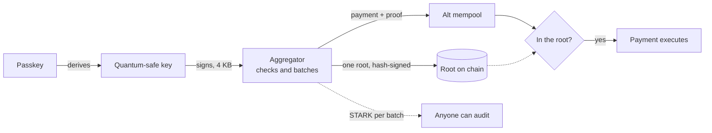

# QueueBit

**A quantum-safe wallet for Ethereum, today.** Open it with a passkey; every payment is signed with a hash-based key a
quantum computer can’t forge, and costs about as much as an ordinary one.

Try it: [queuebit.space](https://www.queuebit.space) (public EIP-8141 devnet, chain 1337).

## The problem

Quantum computers will break ECDSA, the signature behind almost every Ethereum account. Hash-based signatures are the
safe replacement, but they are big: a leanSPHINCS signature is 4 KB, and checking one on chain costs about
**383,000 gas** (around $11 at 10 gwei).

## The idea: one root per batch

Following [EIP-8288](https://eips.ethereum.org/EIPS/eip-8288), signatures are checked off chain and the chain keeps
only a small proof:



1. Your passkey derives a **leanSPHINCS** owner key; nothing secret is stored.
2. The **aggregator** checks each signature, batches them, and posts **one Merkle root**, itself signed with a
   hash-based key (SPHINCS- C13).
3. Each payment only proves it is **in that root**. The account’s check fits the ERC-8421 alt mempool’s budget with no
   stake.
4. Every batch gets a **recursive STARK** anyone can verify against the chain.

| | Gas per payment | Signature on chain |
|---|---|---|
| PQ signature checked in the EVM | 383,018 | ~5.7 KB |
| **QueueBit** | **85,598** (4.5× less) | **0 bytes** |

Measured on the devnet over 20 payments.

## What you can do

- **Pay** with a passkey tap; the first payment also creates your account.
- **Move in any wallet**: MetaMask or any EOA (or keep its address with EIP-7702), a **Safe** (its owners sign once and
  it becomes your PQ account), or an upgradeable smart account (upgraded in place).
- **Pay privately with no relayer**: make funds private with Privacy Pools, then send from a brand-new address that
  never held ETH. The pool pays the gas inside the same frame transaction, which only frame transactions allow.
  Kohaku-compatible.
- **Let someone spend** within limits you set (per payment, per day, until a time you pick), or use your MetaMask as a
  capped session key.
- **Guardians** can reset your keys if you lose your passkey, after a delay you can cancel.

## How it’s built

| Path | What |
|---|---|
| [`contracts/`](contracts/) | LeanAccount (ERC-8286 + ERC-7579), its keystore, spending-limit hook, guardian recovery; the root registry and `PQAggregator`; the privacy paymaster |
| [`services/leanpool-node`](services/leanpool-node/) | The aggregator: verifies, batches, posts roots, proves STARKs |
| [`packages/account`](packages/account/) | The SDK: keys, sessions, grants, migration, Safe adapter |
| [`apps/web`](apps/web/) | The wallet ([queuebit.space](https://www.queuebit.space)): onboarding, Send, private balance, permissions |
| [`apps/extension`](apps/extension/) | The browser extension and the wallet engine both apps run |
| [`packages/privacy`](packages/privacy/), [`packages/groth16`](packages/groth16/) | Privacy Pools client and an in-browser Groth16 prover |
| [`packages/lean-sphincs`](packages/lean-sphincs/) | The owner key’s signature scheme (Rust → WASM) |
| [`docs/`](docs/) | [Architecture](docs/ARCHITECTURE.md), [threat model](docs/security/THREAT-MODEL.md) |

## Run it

Requirements: Node ≥ 22.12, pnpm 10, Foundry 1.3.5, Bun 1.3.

```sh
git clone --recurse-submodules https://github.com/RomarioKavin1/QueueBit && cd QueueBit
pnpm install --frozen-lockfile
pnpm --filter @queuebit/web dev          # the wallet at http://localhost:3000
pnpm test && (cd contracts && forge test)
```

Hosting the wallet and your own aggregator: [`apps/web/SELF-HOSTING.md`](apps/web/SELF-HOSTING.md). A local devnet:
[`devnet/README.md`](devnet/README.md).

## Status

A hackathon prototype on a devnet, not audited. EIP-8141, EIP-8288 and ERC-8421 are drafts. What each key can and
can’t do, and what the aggregator is trusted for: [threat model](docs/security/THREAT-MODEL.md). Report issues
privately: [`SECURITY.md`](SECURITY.md).

MIT. Third-party code and assets: [`THIRD_PARTY.md`](THIRD_PARTY.md). Contributing:
[`CONTRIBUTING.md`](CONTRIBUTING.md).
