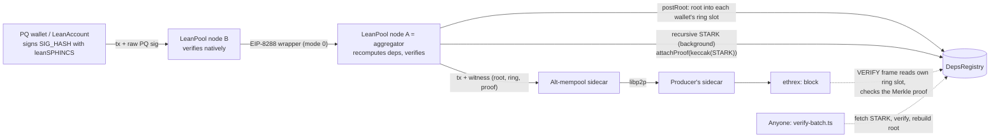

# LeanPool in QueueBit: the quantum-safe everyday key

> **Superseded (2026-11-06).** The hot signer described here (`LeanPoolHotSigner`, `hotExecuteFrom`) was removed when
> LeanAccount became QueueBit's account: the keystore takes LeanPool approvals directly for the PQ owner key
> ([`../plan/70-leanaccount-rebuild.md`](../plan/70-leanaccount-rebuild.md), [`../ARCHITECTURE.md`](../ARCHITECTURE.md)).
> The LeanPool node, the leanSPHINCS WASM signer and DepsRegistry described below are unchanged.

*Ported from LeanPool (`LeoFranklin015/Queue-bit`, `main` @ `53732b1`) on 2026-11-06. Plan and decisions:
[`../plan/60-leanpool-merge-plan.md`](../plan/60-leanpool-merge-plan.md). Trust: THREAT-MODEL §8.1.*

## What QueueBit took, and where it went

| LeanPool | In QueueBit | Notes |
|---|---|---|
| `DepsRegistry`, `MerkleLib` | `contracts/src/leanpool/` | unchanged behaviour |
| `LeanWallet8288`'s VERIFY | `contracts/src/roles/LeanPoolHotSigner.sol` (+ factory) | a clone that spends through `account.hotExecuteFrom`, under the everyday limits |
| `ts/v2` node, wrapper, deps, prover | `services/leanpool-node` | Node 22, `@queuebit/frames`, env config, `leanpool_getTx`, Dockerfile |
| `@kevaundray/lean-pq` signing (native) | `packages/lean-sphincs` (WASM) | byte-identical keys and signatures (vectors from native 0.7.0) |
| test wallet's send checks and stage tracker | extension: payments pre-check, activity steps | |
| LeanAccount, KeystoreValidator, passkeys | not ported (later ERC-8286 track) | |
| v1 (BatchRegistry, keccak fraud game) | dropped | |

## Live on the public devnet (QueueBit contracts, 2026-11-06)

`contracts/devnet-tests/leanpool` (record: `last-run.json`), chain 1337, `altmempool.forshtat.com`:

| Step | Evidence |
|---|---|
| `DepsRegistry` / `LeanPoolHotSignerFactory` | `0x65a64Ab43aB280b7Ed0c4be422eC044D60a0225F` / `0x226ea7C2672864A48C7c0EE5A923d3A89173f1bE` |
| Account (bound mode, C13 Vault) | `0x26905DFa39111B4b52F528917dd91C049e5D5825` |
| Signer created by the fee tank | `0x69F4F1982964695bB67D1e403891ee8a4BF2Ef3C` (452,994 gas) |
| Vault installs it (Path B, public mempool) | `0x459691956e8d9a8d4f4e79b07f9b9619c8173d86f890cf2a2949fef8080aaaa4`, block 4410 |
| Quantum-safe everyday payment, 0.001 ETH ($3) | [`0x42810126…6659`](https://explorer.altmempool.wtf/tx/0x42810126a9135048df98094746e3b2072e9232ef4812a9cd4840c44ca5e66659?node=https%3A%2F%2Faltmempool.forshtat.com%2Frpc), block 4414: VERIFY **61,449** gas, 0 signature bytes on-chain, leanSPHINCS signed in WASM in 101 ms |
| Same tx, canonical mempool | refused: `StorageReadNonSender` |
| Everyday bucket | debited exactly $3 (shared with the ECDSA everyday key) |
| Over-limit payment ($9 > $8) | refused by the pre-check, never signed |
| Batch STARK | 194,992 bytes, proved in 63 s, hash `0x0793feb0…aa91` attached; `verify-batch`: **VALID** |

### Re-run with the queued install (after review)

Installing the signer is now loosening, so the Vault queues it and anyone executes it after the timelock (1 h here).
Account `0x2Fb762124AABc1eF602741507Eb42B3592f78745`, signer `0x78BB392652d6E86DAD412aca2e2b3Fba0e3984c7`:

| Step | Evidence |
|---|---|
| Vault queues `vaultSetPQHotSigner` (Path B) | `0x0336f601ea689d3ce03b02fb513c7116925be4591bdd94657d281c610e2134d9`, block 5083, op `0x0f10086e…` |
| Executed after the timelock, by anyone | `0xc4411502af5e1ea550a6bee7f1f49fb9720b2f75496e16845b3e874acf9b1f4f` |
| Quantum-safe everyday payment | [`0x84a29e24…`](https://explorer.altmempool.wtf/tx/0x84a29e24f8877eb2772d400f1cd748f052acc11742b76fbdd8eec429b3b0d2f7?node=https%3A%2F%2Faltmempool.forshtat.com%2Frpc), block 5688: VERIFY 61,449 gas, 0 signature bytes on-chain |
| Same tx, canonical mempool | refused: `StorageReadNonSender` |
| Over-limit payment | refused before signing |
| Batch STARK | `0x646f21f9…` attached; `verify-batch`: **VALID** |

## LeanPool's original explainer

The rest of this page is LeanPool's own design write-up as of `53732b1`, kept for its reasoning and its earlier live
evidence (its addresses are LeanPool's, not QueueBit's).

---


*As of 2026-11-06. Repo: [`LeoFranklin015/Queue-bit`, branch `leanpool`](https://github.com/LeoFranklin015/Queue-bit/tree/leanpool).*

## TL;DR

LeanPool lets an Ethereum account sign with post-quantum keys today, on EIP-8141 frame transactions. It needs no
hard fork, and the 100k VERIFY budget no longer rules PQ signatures out.

A PQ signature (leanSPHINCS, about 3 KB) is too big and too expensive to verify in every transaction. So LeanPool
nodes verify the signatures off-chain, batch them, and post one root per batch. The account's VERIFY frame only
checks "my signature hash is in a committed root". That read breaks the canonical mempool's rules, so LeanPool runs
on the frame transaction alternative mempool, which exists for exactly this kind of case.

- **4.5× less gas per transaction**: 85,598 gas per tx, against 383,018 when the PQ signature is verified in the
  EVM. Measured over 20 real transfers each on the live devnet.
- **No signature bytes on-chain**, against 113,680 bytes for the same 20 txs.
- **No stake for wallets.** The v2 wallet reads only storage keyed by its own address, so the alt mempool admits it
  unstaked.
- **Shaped like EIP-8288.** Same dependency triples, same wrapper, real recursive leanVM STARKs. It is a bridge to
  EIP-8288's frame mode 4 for when that ships.
- **A real account on top.** LeanAccount is an ERC-8286 + ERC-7579 modular smart account. It has a keystore (PQ,
  passkey, P256 and ECDSA keys), weighted multisig, key rotation, session keys, spending caps and guardian recovery.

If you build a wallet, a dapp or an account, you can plug into LeanPool. You don't have to build PQ signing,
aggregation and mempool plumbing yourself.

---

## 1. The problem

Post-quantum signatures don't fit the way frame transactions validate, so no account today can use them for
everyday transactions.

EIP-8141 frame transactions let an account validate itself in a VERIFY frame. The mempool gives that frame a flat
budget of 100,000 gas (`MAX_VERIFY_GAS`), and the canonical mempool lets it read only the sender's own storage.

| | ECDSA | leanSPHINCS (PQ) |
|---|---|---|
| Signature size | 65 bytes | about 3 KB (113,680 bytes for 20 txs) |
| Cost to verify in the EVM | about 3k gas | 383,018 gas per tx end to end (measured, `DirectPQWallet`) |
| Fits the 100k VERIFY budget | yes | no |
| Quantum-safe | no | yes |

EIP-8288 solves this with a hard fork: a new frame mode 4, and a recursive STARK in the block header, so the
protocol verifies every signature once per block. That is the right end state, but it needs consensus changes.

LeanPool gets the same result now. It moves signature verification off-chain into a mempool layer and leaves the
account a cheap Merkle check. That check reads a registry the account does not own, and the canonical mempool refuses
such reads (`StorageReadNonSender`). The frame transaction alternative mempool can admit the read under clear rules.

## 2. How it works



The life of one transaction:

1. **Sign.** The wallet builds the frame tx. Its VERIFY frame data carries an EIP-8288 dependency triple
   `(0x10, data_hash, vk)`. The wallet signs the tx's `SIG_HASH` with its leanSPHINCS key. Signature entry 0 is
   left empty for the witness: it is an ARBITRARY entry, whose bytes are elided from the sig hash, so it can be
   filled in later.
2. **Submit.** The wallet sends `{raw, sigs}` to any LeanPool node (`leanpool_sendTransaction`). The node verifies
   the signature natively (0.2 ms) and checks the key matches the one the wallet holds.
3. **Gossip.** Nodes exchange EIP-8288 wrappers `[transactions, mode, content]`. Mode 0 carries raw signatures and
   mode 1 carries one recursive STARK. A receiving node never trusts a wrapper: it recomputes the dependencies from
   the txs and verifies every signature or proof.
4. **Batch.** Every 1000 ms the aggregator builds a sorted, deduplicated Merkle tree over the leaves
   `(0x10, sigHash, vk)`. It posts the root to `DepsRegistry`, which writes it into a small 8-entry ring kept per
   wallet: `rings[aggregator][wallet]`.
5. **Prove.** In the background the aggregator builds a recursive leanVM STARK over the batch's signatures. It
   attaches `keccak256(STARK)` on-chain and serves the STARK by that hash (`leanpool_getStark`).
6. **Deliver.** The node fills the witness `(root, ring index, proof)` into entry 0 and submits the tx to its
   alt-mempool sidecar. The tx travels over libp2p to the block producer's sidecar and into a block.
7. **Validate.** The wallet's VERIFY frame reads its own ring slot, checks that the root is there, verifies the
   Merkle proof for its leaf, and calls `APPROVE`. This costs a few thousand gas, not 383k.
8. **Audit.** Anyone can run `ts/v2/scripts/verify-batch.ts`. It fetches the STARK, verifies it, and rebuilds the
   posted root from the STARK's claims.

## 3. Why it is safe for builders

LeanPool relaxes only one rule beyond the canonical mempool, and it is the standard ERC-7562 one: a VERIFY frame may
read storage associated with the sender. Builders take on no new risk of one write invalidating many transactions.

| Rule | Canonical mempool | LeanPool v2 on the alt mempool | Why it is safe |
|---|---|---|---|
| Storage | Sender's own storage only | Reads `rings[aggregator][wallet]` in DepsRegistry | The slot is `keccak(wallet ‖ …)`, which ERC-7562 STO-021 counts as the sender's. One write can only invalidate that one wallet's txs. |
| Stake | Not needed | Not needed (0 stake; the explorer's Reputation tab shows it) | Nothing shared can be invalidated, so there is nothing for stake to price. |
| Gas | 100k VERIFY budget | Each VERIFY stays under 100k (v2 txs used 51 to 71k gas *in total*) | The expensive part, signature verification, runs off-chain. |
| Signature bytes | Counted in the sig hash | The witness rides in an ARBITRARY entry, elided from the sig hash | The PQ key signs before its batch exists; the node fills in the witness afterwards. |
| Who writes the root | n/a | Only the aggregator the wallet named (set by the wallet itself) | A stranger's bond buys no access, and nobody can block a root by posting it first. |

What a wallet still trusts is narrow: that the aggregator it chose is honest. The EVM cannot verify leanVM
signatures or STARKs yet, so v2 has no on-chain slashing. Instead every batch has a recursive STARK whose hash is
on-chain, and anyone can check it. A wallet whose aggregator fails that check moves to another one. v1 had an
on-chain fraud game with slashing, at the cost of making wallets stake (see §7).

## 4. Evidence: live on the devnet

Mined transactions on the EIP-8141 devnet (chain 1337, after its 2026-11-06 reset) back every claim above. The
unstaked wallet is `0xB44b1A1a19fE7959aCfC58d4b91c29BF691d3bAd`.

| What it proves | Tx | Block |
|---|---|---|
| Same tx, two mempools: canonical rejects (`StorageReadNonSender`); the alt mempool admits it unstaked and mines it | [`0xb101bd40…784d`](https://explorer.altmempool.wtf/tx/0xb101bd403bfa43526632c7a721d2f6b4c2fc0ff37dec2a13cc526f4482a3784d?node=https%3A%2F%2Faltmempool.forshtat.com%2Frpc) | 362 |
| Batched PQ tx on nonce lane 1, gossiped as an EIP-8288 mode 0 wrapper | [`0xaa81be8b…a67f`](https://explorer.altmempool.wtf/tx/0xaa81be8b86fcc0314bab85e3bd50a41854314ec2b9e704480dbb16ba0e23a67f?node=https%3A%2F%2Faltmempool.forshtat.com%2Frpc) | 358 |
| Batched PQ tx, nonce lane 2 | [`0x3494cdae…33e6`](https://explorer.altmempool.wtf/tx/0x3494cdae3b09c5a7c75ee34f02a8646e0c9300b8454686396f46519e816a33e6?node=https%3A%2F%2Faltmempool.forshtat.com%2Frpc) | 358 |
| Batched PQ tx, nonce lane 3 | [`0xf9adabe2…5a08`](https://explorer.altmempool.wtf/tx/0xf9adabe230e3ac861eecefec18c25faab3956f832f1e8c4a147e4d64a7ea5a08?node=https%3A%2F%2Faltmempool.forshtat.com%2Frpc) | 358 |
| Batch root written into the wallet's own ring slot | `0xad516f79879dea77c45c6d6917e62a732a9a1e019b831861625e02a280321960` | 352 |
| The batch's recursive STARK hash, attached on-chain | `0x85c886e2654507b47c647cac8c37d13ff6daf700b7ba3bc42a255dec1c6ec512` | 359 |

**LeanAccount (ERC-8286), live.** The first account, with one ECDSA key and no stake, was mined in block 2422:
[`0xd1bef02f…e8ff`](https://explorer.altmempool.wtf/tx/0xd1bef02f6c914fd9c2b48de3e74998c83d955003253c81cfb820d952bc75e8ff?node=https%3A%2F%2Faltmempool.forshtat.com%2Frpc) (VERIFY 63,619 gas). The canonical mempool
rejects these txs (`StorageReadNonSender`, because VERIFY reads the keystore's storage); the alt mempool admits them
unstaked.

The full keystore run (`bun ts/account/scripts/live-keystore.ts`, record in
[`deployments/account-live.json`](../deployments/account-live.json)) uses one account,
`0xD0fA986F138F6C2421ab3559e61b17b16d822B53`. Its keystore holds two PQ keys, a device P256 key and a passkey. Policy:
spending needs 1 signer; admin actions need 2, at least one of them PQ.

| Step | Tx | Block | VERIFY gas | Total gas |
|---|---|---|---|---|
| 1. Spend, device P256 key alone (protocol-verified entry) | [`0x96b97d92…edcb`](https://explorer.altmempool.wtf/tx/0x96b97d9211ddc21382c5b41572519a48abf92c04b72d0d790d3035fb63f0edcb?node=https%3A%2F%2Faltmempool.forshtat.com%2Frpc) | 2705 | 63,580 | 126,162 |
| 2. Spend, PQ key A alone (LeanPool, one dependency) | [`0x6d8f2258…5714`](https://explorer.altmempool.wtf/tx/0x6d8f22588a0ab785ffc497cda5fcb5d1c9925d2d9a09ef6d5feb3b5c07ca5714?node=https%3A%2F%2Faltmempool.forshtat.com%2Frpc) | 2710 | 54,868 | 113,993 |
| 3. Admin batch: add a session key and its daily cap; PQ-A + device key | [`0x44c2394e…6035`](https://explorer.altmempool.wtf/tx/0x44c2394edbdf95710a5a7b9af8a23898429efa772ce6590c922417a6283b6035?node=https%3A%2F%2Faltmempool.forshtat.com%2Frpc) | 2715 | 61,667 | 706,542 |
| 4. Spend 600 wei, session key alone (allowlist, per-tx cap, daily cap) | [`0x88133f68…9c55`](https://explorer.altmempool.wtf/tx/0x88133f685cffc23320735389fbab247ed3db54fe18ee48834273b44665519c55?node=https%3A%2F%2Faltmempool.forshtat.com%2Frpc) | 2720 | 46,136 | 234,580 |
| 5. Batch: two transfers in one execute, PQ-A | [`0xb25936db…94fc`](https://explorer.altmempool.wtf/tx/0xb25936db831c20bb076c5e89f9772c04ac864be7c7ecbb781ef34f1ec24d94fc?node=https%3A%2F%2Faltmempool.forshtat.com%2Frpc) | 2725 | 58,178 | 131,316 |
| 6. Rotate PQ-B to PQ-C; PQ-A + PQ-B (two PQ dependencies) | [`0x3e5440ea…75b8`](https://explorer.altmempool.wtf/tx/0x3e5440eaf9c77f4b05d81100ab0418f51430ac7cf10530c4805f1d8ee76675b8?node=https%3A%2F%2Faltmempool.forshtat.com%2Frpc) | 2730 | 57,341 | 369,158 |
| 7. Revoke the session key; PQ-A + PQ-C (the rotated-in key) | [`0x860f0932…50c3`](https://explorer.altmempool.wtf/tx/0x860f093207f2e800a4b76c390c84bc7d67915abd036648fb14707cb4fc1f50c3?node=https%3A%2F%2Faltmempool.forshtat.com%2Frpc) | 2735 | 57,047 | 141,549 |

Every LeanPool batch above also got its recursive STARK hash attached on-chain (hashes in the record). Three
refusals ran in the same session, as intended:

- **After the rotation, PQ-B signs an admin action:** the LeanPool node refuses it at intake, because PQ-B is no
  longer in the keystore.
- **The device key alone signs an admin action:** the account refuses it (`ValidationFailed`): below the admin
  threshold, and no PQ signer.
- **A passkey (WebAuthn) spend:** refused by the precompile rule, explained next.

**Passkeys and the devnet's precompile list.** WebAuthn is verified in VERIFY with SHA256 (0x02) and P256VERIFY
(0x100); it uses 83,323 gas, inside the 100k budget. ERC-7562 rule OP-041 exempts precompiles from its ban on calling
code-less addresses, but a sidecar only knows the precompiles its config lists. The devnet's sidecar lists none
(`"precompiles": []`). Our sidecars now list the 18 precompiles that `bun ts/scripts/probe-precompiles.ts` verified
on the devnet (0x01–0x11 and 0x100), and they admit the passkey tx
(`0x5b9059fbeae1de31dc8f246b5fa43fddb29ed01af48cfb7fa187cb05e8a080b7`, `ts/account/scripts/passkey-live.ts`). The
producer's sidecar validates gossiped txs again under its own config, so passkey txs are mined once the operator adds
the same list. A control tx through the same sidecar (ECDSA key, no precompiles) was mined at once:
[`0x85795c01…d8b4`](https://explorer.altmempool.wtf/tx/0x85795c01c009969fd9a8af3417d3669708cc2b865cbc718de7f5ac7d2496d8b4?node=https%3A%2F%2Faltmempool.forshtat.com%2Frpc).

The explorer lists only frame txs, so it doesn't show the root and STARK-hash txs in the first table. Check them with
`cast receipt <tx> --rpc-url https://altmempool.forshtat.com`. To check any tx end to end (witness, Merkle proof,
ring slot, STARK claims, stake), run `bun ts/v2/scripts/verify-txs.ts <tx>`.

**Measured gas, 20 transfers each, real receipts** (`bun ts/v2/scripts/gas-compare.ts 20`):

| Setup | Gas per tx | PQ signature bytes on-chain | Wallet stake |
|---|---|---|---|
| PQ signature verified in the EVM (`DirectPQWallet`) | 383,018 | 113,680 | none |
| **LeanPool v2** (20 txs + 2 root posts + 2 STARK hashes) | **85,598** | **0** | **none** |
| LeanPool v2, not counting the STARK-hash txs | 72,537 | 0 | none |
| LeanPool v1 (before the reset) | 62,459 | 0 | 0.012 ETH |

Off-chain costs on a 2-core ARM machine:

| Operation | Cost |
|---|---|
| leanVM signing | about 30 ms |
| Native verify | 0.2 ms |
| STARK over 16 signatures | 51 s, about 195 KB |
| Verifying a STARK | 55 ms |

## 5. The product: LeanAccount

LeanAccount is a modular smart account for frame transactions whose security can rest on post-quantum keys. It
follows ERC-8286 (modular accounts for frame transactions) and ERC-7579 (modules), so existing 7579 tooling and
modules carry over. Its spec is in [`SPEC-account.md`](../SPEC-account.md).

| Part | Standard | What it does |
|---|---|---|
| `LeanAccount` | ERC-8286 + ERC-7579 | `verify(bytes)` runs in the VERIFY frame and checks the frame mode. It masks the approval by the frame's allowed scope and refuses execution unless every SENDER frame targets the account. Then it calls `APPROVE`. `execute` and `executeFromExecutor` handle single and batch calls, atomic or try. One hook, many executors, many validators. |
| `KeystoreValidator` | ERC-8286 frame validator (type 11) | Holds each account's keys and policy. Key kinds: **PQ** (leanSPHINCS via LeanPool), **PASSKEY** (WebAuthn, verified in the EVM with the P256VERIFY precompile), **P256** and **ECDSA** (protocol-verified entries). |
| Roles and weights | | Each key has a weight, roles (ADMIN, SPEND, SESSION) and an expiry. Separate admin and spend thresholds give weighted k-of-n multisig across key kinds. |
| `requirePQ` | | Every admin action needs a PQ signer. An attacker who breaks ECDSA or P256 still cannot change the keys. |
| Session keys | | A SESSION key may only call its allowlisted targets, within a value cap per tx. |
| `SpendingLimitHook` | ERC-7579 hook | Daily ETH caps per session key, recorded around `execute` (VERIFY cannot write state). |
| `GuardianRecovery` | ERC-7579 executor | Guardians approve a new key set; guardians can be any address, including other PQ accounts. After a delay anyone can trigger the change, and the account can cancel it. |
| `LeanAccountFactory` | EIP-1167 + CREATE2 | Cheap clones at a predictable address; creating the same account twice is a no-op. |

**Safe by construction.** After every add, remove, rotate or policy change, the keystore checks two things. Admin
and spend weight must still meet their thresholds. With `requirePQ` on, at least one PQ admin key must remain. You
cannot lock yourself out or quietly drop PQ protection.

**Migration that keeps your address.** An account that starts with an ECDSA key adds a PQ key, removes the ECDSA key
and turns on `requirePQ`. That is ERC-8286's point: swap validation, keep the account. The Forge suite runs this
flow.

**Unstaked by design.** Every storage slot the keystore reads in VERIFY uses the account as the innermost mapping key
and holds fixed-size fields. A `vm.load` test pins those slots, so the account stays admissible to the alt mempool
without stake.

**Privacy is designed in, not built yet.** The plan covers ERC-5564 stealth receiving, private exits through a
privacy-pool paymaster, and key commitments instead of raw keys. Nothing in the account blocks them: `execute` can
reach any target, and each key is a fixed-size blob by kind.

## 6. Build on top of LeanPool

Use LeanPool as your PQ signing layer. There are three ways in, from least to most work.

| You are | Use | You get |
|---|---|---|
| A wallet that wants PQ accounts | `LeanAccountFactory` + the account SDK ([`ts/account/sdk.ts`](../ts/account/sdk.ts)) | A full smart account with PQ keys, passkeys, multisig, sessions and recovery. Users keep one address while they move to PQ. |
| An existing ERC-7579 / ERC-8286 account | Install `KeystoreValidator` as a frame validator | PQ keys next to your current validators, without moving funds. |
| An account with its own design | Node RPC `leanpool_sendTransaction`, plus a Merkle check against `DepsRegistry` | Aggregation and alt-mempool delivery. You write the check; see [`LeanWallet8288.sol`](../contracts/src/v2/LeanWallet8288.sol). |

**Send a PQ transaction from a simple wallet** ([`ts/v2/sdk.ts`](../ts/v2/sdk.ts)):

```ts
const lp = await LeanPoolV2.open({ wallet, node: "http://127.0.0.1:8702" });
const { txHash } = await lp.send({ to, value: 1n, data: "0x" }); // signs SIG_HASH with leanSPHINCS
await lp.waitIncluded(txHash); // the node batches it, posts the root and submits it
```

**Create a LeanAccount and send with any mix of signers** ([`ts/account/sdk.ts`](../ts/account/sdk.ts)):

```ts
const account = await createAccount(d, {
  salt,
  policy: { adminThreshold: 2, spendThreshold: 1, requirePQ: true, aggregator },
  keys: [
    { kind: KIND.PQ, weight: 1, roles: ROLE.ADMIN | ROLE.SPEND, a: pqVk },
    { kind: KIND.PASSKEY, weight: 1, roles: ROLE.ADMIN | ROLE.SPEND, a: qx, b: qy },
  ],
});
const plan = await buildAndSign({
  d, account, nonceKey: 1n, nonceSeq: await keyedNonce(account, 1n),
  calls: [[{ to, value }]],
  signers: [{ kind: "PQ", vk: pqVk, sign }, { kind: "PASSKEY", keyId, sign: webauthnSign }],
});
await submit(plan); // PQ txs go to a LeanPool node; the rest go straight to the alt mempool
```

The node API is small:

| Method | Use |
|---|---|
| `leanpool_sendTransaction {raw, sigs}` | Submit a tx |
| `leanpool_getStark [proofHash]` | Fetch a batch's proof |
| `leanpool_status` | Node status |
| `leanpool_wrapper` | Node-to-node: batches travel as EIP-8288 wrappers |

Any team can run its own node or its own aggregator with the same formats.

**Why build on us rather than alone:**

- **Cost.** Sharing an aggregator spreads the root post over every wallet in the batch. Verifying PQ signatures
  yourself costs 383k gas per tx.
- **Standards.** The formats are EIP-8288's and the account is ERC-8286 / ERC-7579. When frame mode 4 lands, the
  signing side stays the same and only the check moves into the protocol.
- **Admission.** The storage layout is already shaped for unstaked alt-mempool admission, and it's tested. Getting
  this wrong is the usual reason a custom VERIFY gets refused.
- **Tested.** 66 Forge tests pass (26 on the account), using a real P256VERIFY and real WebAuthn vectors. The v2 node has bun tests
  and has run on the live devnet.

## 7. Design decisions and why

| Decision | Chosen | Alternative | Why |
|---|---|---|---|
| Where signatures are verified | Off-chain, in LeanPool nodes | In the EVM | 383k gas per tx and 3 KB calldata don't fit a 100k VERIFY budget. |
| Where the root lives | A ring of 8 per wallet, `rings[aggregator][wallet]` (v2) | One shared registry slot (v1) | A shared slot lets one write invalidate many wallets' txs, so the alt mempool makes v1 wallets stake 0.012 ETH. A per-wallet slot is the sender's own storage, so v2 needs no stake. |
| Accountability | Recursive STARK hash on-chain; anyone can verify it (v2) | Challenge and slash on-chain (v1) | The EVM can't verify leanVM signatures yet. v1's fraud game needed keccak leanSPHINCS and staked wallets. |
| Proof mode on the hot path | Mode 0 (raw signatures) every 1000 ms; STARKs in the background | STARK before every root | A STARK over 16 signatures takes 51 s on this machine. EIP-8288 itself recommends raw signatures below about a hundred. |
| Where the dependency triples go | VERIFY frame data, inside an ERC-8286 envelope | Frame mode 4 | The devnet has no mode 4. The sig hash covers frame data, so the triples are still signed. |
| Account standard | ERC-8286 + ERC-7579 | A custom account | Existing modules and tooling carry over, and validation can be swapped without moving the account. |
| Passkeys | WebAuthn verified in the account (ARBITRARY entry + P256VERIFY) | Native P256 entry | WebAuthn signs `authenticatorData ‖ sha256(clientDataJSON)`, which a native entry cannot carry. |
| Frame helpers | One shared helper set (`FrameHelperHub`) for the account and all modules | One set per contract | Each distinct helper is a cold account access, 2,600 gas each, inside the 100k budget. |

## 8. Status, limits and roadmap

**Done and live:**

- v1 (before the reset) and v2 on the devnet: admitted, mined, verified, and gas measured.
- A local test wallet UI for v2 (`ts/v2/wallet`).
- The LeanAccount contracts: account, keystore, passkeys, hook, recovery and factory: 70 Forge tests across v1, v2 and
  the account, including a real P256VERIFY and real WebAuthn vectors.
- **LeanAccount live on the devnet** (§4): PQ alone, PQ + device key, 2-of-n PQ multisig, session key with a daily
  cap, batching and key rotation, all admitted unstaked and mined. VERIFY stays at 46k–64k gas against the 100k
  budget, after the work below cut it from 134k:
  - one shared set of frame helpers, called with raw assembly;
  - one storage slot per module;
  - single-slot key reads;
  - a WebAuthn verifier in assembly (90k down to 10k gas).
- **Multi-dependency LeanPool:** a tx can carry up to 16 PQ signers. The node checks each key against the keystore
  the tx names, refuses what the contract would refuse (another validator, a foreign data hash, an expired or removed
  key), builds the witness `(root, ring, proofs[])` in triple order, and proves the batch with one STARK.

**Waiting on the devnet operator:**

- **Passkey txs mined:** the producer's sidecar must list the precompiles (§4). Ours already do.

**Next:**

- Guardian recovery live. Also fix `GuardianRecovery` so an uninstall clears the old guardians.
- Migration from a real Safe v1.4.1 (same k-of-n, moving assets in one MultiSend).
- A wallet app with in-browser passkeys and a migration wizard.

**Known limits:**

- No on-chain slashing in v2.
- A wallet's ring holds 8 roots, so a 9th pending batch evicts the oldest.
- The first write to a ring slot costs about 111,675 gas under the devnet's state-gas model.
- STARK proving is slow on small machines.
- Privacy features are designed, not built.
- Session caps are in ETH only (no token or USD caps).

**When EIP-8288 ships:** the triples move into frame mode 4, the protocol checks the block's recursive STARK, and the
DepsRegistry read goes away. Wallet signing and the node's wrapper formats stay the same.

## 9. Repo map and how to run it

| Path | What |
|---|---|
| `contracts/src/v2/` | `DepsRegistry`, `LeanWallet8288` |
| `contracts/src/account/` | `LeanAccount`, `KeystoreValidator`, `WebAuthn`, `SpendingLimitHook`, `GuardianRecovery`, `LeanAccountFactory`, `FrameOps` |
| `contracts/src/` | v1: `BatchRegistry`, `LeanWallet`, `DirectPQWallet` (baseline), `MerkleLib` |
| `ts/v2/` | v2 node (`server.ts`, `node.ts`), EIP-8288 deps and wrapper, prover, SDK, scripts, test wallet |
| `ts/account/` | Account SDK, WebAuthn signer, deploy and smoke scripts |
| `ts/node/`, `ts/sdk/` | v1 node, watcher and SDK |
| `sidecars/` | Two alt-mempool sidecars (`skandha`) that peer with the devnet producer |
| `deployments/` | Addresses per version |
| `SPEC.md`, `SPEC-v2.md`, `SPEC-account.md` | Specs and task lists |

```sh
bun install
cd contracts && forge test && cd ..   # v1, v2 and account contract tests
bun test                              # node, wrapper, deps, wallet and WebAuthn tests
./run-nodes-v2.sh                     # sidecars + two v2 nodes (A aggregates)
./demo-v2.sh                          # a v2 run on the devnet
bun ts/v2/wallet/server.ts            # test wallet on 127.0.0.1:8787 (ssh -L 8787:127.0.0.1:8787)
```

License: MIT.
